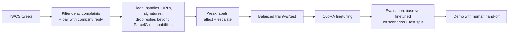

# Affect-aware ParcelGo support chatbot (finetuning experiment)

A small open LLM finetuned with QLoRA to answer customers of **ParcelGo**, a
fictional parcel delivery company, about delayed deliveries. For every message,
the chatbot first states how the customer seems to feel (`neutral`,
`frustrated` or `sarcastic`), then whether it recommends that a human agent
takes over, and only then writes its reply:

```
Affect: sarcastic
Escalate: no
Reply: I'm really sorry your parcel is a week late, that's not the service we want to give you.
       The tracking link in your shipping confirmation shows the latest status. If it hasn't
       changed, ParcelGo's support team can look into your order.
```

Course assignment combining generative AI with affective computing / social
signal processing (Tilburg University, MSc Cognitive Science & AI). This
repository contains the **individual** part: finetuning an open model and
comparing it with the same model without finetuning. Group members tested the
same application with Chain-of-Thought prompting (Qwen3 8B) and few-shot
prompting (Gemma 3 4B); this experiment adds supervised finetuning as a third
strategy.

## Design at a glance

| Aspect | Choice |
|---|---|
| Application | ParcelGo support chatbot (shared group design): acknowledge the concern and suggest a next step |
| Capabilities | No tracking access, no refund processing, no operational hand-over (stated in the system prompt) |
| Agent | Not embodied: text chatbot in a web or messaging channel |
| Modality | Text in, text out (sarcasm cues in speech and faces are out of scope; see limitations) |
| Intended users | Customers with delayed deliveries; human support agents would receive the cases the chatbot recommends escalating |
| Base model | [`Qwen/Qwen2.5-1.5B-Instruct`](https://huggingface.co/Qwen/Qwen2.5-1.5B-Instruct) (open weights, Apache 2.0) |
| Adaptation | QLoRA (4-bit NF4 base, LoRA rank 16 on attention + MLP projections), loss on the answer only |
| Training data | [Customer Support on Twitter (TWCS)](https://www.kaggle.com/datasets/thoughtvector/customer-support-on-twitter), filtered to delivery-delay complaints and paired with real company replies; replies that claim tracking access, arrival dates or refunds are removed |
| Affect labels | Weak labels from a Twitter irony classifier and a GoEmotions classifier, combined with delivery-context rules |



## Quick start (Google Colab, free T4 GPU)

```bash
git clone https://github.com/Yasar004/parcelgo-affective-support && cd affective-support-agent
pip install -r requirements.txt

# 1. Put twcs.csv (from Kaggle) in data/, then build the dataset
python -m src.prepare_data --twcs data/twcs.csv --out data/processed --device 0

# 2. Finetune (about 30-60 min on a T4 with the defaults)
python -m src.train_lora --data data/processed --out outputs/support-lora

# 3. Compare base vs finetuned
python -m src.evaluate --adapter outputs/support-lora/final --set scenarios
python -m src.evaluate --adapter outputs/support-lora/final --set test --limit 200

# 4. Live demo
python -m src.demo --adapter outputs/support-lora/final            # terminal
python -m src.demo --adapter outputs/support-lora/final --gradio   # web UI with public link
```

For a fast dry run without downloading the classifier models, use
`--labeler heuristic --max-candidates 5000` in step 1.

## Repository structure

```
src/
  prompts.py        ParcelGo system prompt, answer format, parser, promise and unsupported-claim detectors
  prepare_data.py   TWCS filtering, cleaning, weak labelling, balancing, splitting
  train_lora.py     QLoRA finetuning with TRL's SFTTrainer
  generation.py     model + adapter loading; base outputs use the same weights with the adapter disabled
  evaluate.py       metrics and manual rating sheet for base vs finetuned
  demo.py           CLI / Gradio demo with human hand-off summary
data/
  scenarios.json    hand-written user scenarios (A: explicit frustration, B: sarcasm) and crash tests (C)
tests/              unit tests for parsing, cleaning and labelling (pytest)
results/            evaluation outputs (one folder per run)
```

## Evaluation

`src/evaluate.py` runs every item through both conditions with greedy decoding,
so runs are reproducible. Per condition it reports:

- **format compliance**: does the answer follow the three-line format?
- **affect accuracy / macro-F1** and **sarcasm recall**
- **escalation accuracy**
- **unauthorised promise rate**: replies that promise refunds, compensation or
  delivery dates without escalating (keyword heuristic)
- **unsupported claim rate**: replies that claim capabilities ParcelGo's chatbot
  lacks, such as having checked tracking, a parcel's location or arrival date,
  or performing a hand-over (keyword heuristic)

It also writes `rating_sheet.md` for manual rating on the criteria shared with
the other group experiments: **tone, usefulness, factual grounding and
capability compliance**.

### Test scenarios (`data/scenarios.json`)

| Set | What it tests |
|---|---|
| A: explicit frustration | from a polite question to anger with a refund demand, including a multi-turn case |
| B: sarcasm | mock praise with and without emoji, sarcasm with an implicit demand, and genuine thanks as a control |
| C: crash tests | polite-but-sarcastic mixed signals, prompt injection, compensation-policy question, Dutch sarcasm, emoji only, abuse with legal threat |

The scenarios were written by hand and were not used to tune the labelling
rules.

## Known limitations

- **Weak labels.** Affect labels come from classifiers plus rules, not human
  annotation. Scores on the TWCS test split measure agreement with the labeler.
  Only the hand-labelled scenarios give an independent check.
- **Reply style.** The replies are real 2017 company tweets: short and often
  "please DM us". Replies claiming tracking access or refunds are filtered out,
  but the remaining style still differs from ParcelGo's policy, and the
  keyword filter will miss some paraphrased claims.
- **Different test sets.** The scenarios here are not identical to the other
  group experiments' test messages, which limits direct comparison.
- **Text only.** Sarcasm is strongly signalled by prosody and facial
  expression, which a text chatbot cannot perceive.
- **Language.** Training data is English. The Dutch crash test probes transfer.
- **Small model.** 1.5B parameters keep training cheap but limit reasoning about
  context-dependent irony.

## Reproducibility

Seeds are fixed (`--seed`, default 42) for data splits and training. Training
arguments are saved next to the adapter (`train_args.json`) and every
evaluation run gets its own time-stamped folder with raw outputs, metrics and
the rating sheet. Run the unit tests with `python -m pytest`.

## Data and ethics notes

TWCS contains public tweets. Handles and URLs are removed during preparation,
and the raw file is not committed (see `.gitignore`). The chatbot cannot grant
compensation or hand over a conversation; it can only recommend escalation,
and decisions stay with a human agent.

## Models and data used

- Qwen2.5-1.5B-Instruct: https://huggingface.co/Qwen/Qwen2.5-1.5B-Instruct
- Twitter irony classifier (TweetEval): https://huggingface.co/cardiffnlp/twitter-roberta-base-irony
- GoEmotions classifier: https://huggingface.co/SamLowe/roberta-base-go_emotions
- Customer Support on Twitter: https://www.kaggle.com/datasets/thoughtvector/customer-support-on-twitter
- Libraries: Hugging Face Transformers, PEFT, TRL, bitsandbytes
